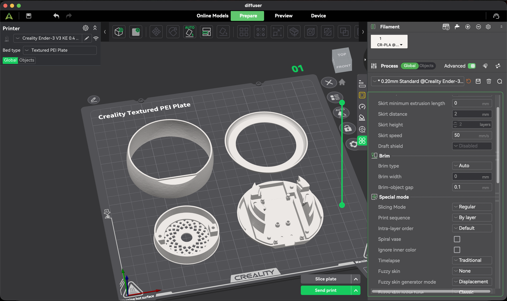

# ESP32 voice assistant – 3D print files

Creality Print project (`esp32-voice-assistant-case.3mf`) for the case of my ESP32 voice assistant, with all parts on one plate and the print settings I used.

## The model is not mine

The case was designed by **ImpatientMaker**: [Supports ESP32 Dev board and speakers with larger magnet](https://www.printables.com/model/927769-supports-esp32-dev-board-and-speakers-with-larger), a remix of JakeB's **"Voice Assist Puck"**.

License: [CC BY-NC 4.0](https://creativecommons.org/licenses/by-nc/4.0/). You must give credit to the original authors and you may not use it commercially. This file only adds my plate layout and slicer settings; the geometry is unchanged. For the original STL files, download them from Printables.

## Print settings

| Setting | Value |
|---|---|
| Printer | Creality Ender-3 V3 KE |
| Filament | 1.75 mm PLA (Creality CR-PLA) |
| Print time | 2 h 28 min |
| Filament used | 47.2 g (15.83 m) |
| Plate | Textured PEI |
| Nozzle | 0.4 mm |
| Layer height | 0.2 mm |
| Infill | 80% |
| Walls | 2 |
| Supports | On |

**Tip:** all parts except the round top cover (the diffuser ring) can be printed together. The LED strip sits inside this cover, so print it separately in white or translucent filament. In black, the LED light will not be visible.

## Build log

The full build is described in the blog series *Building My Own ESP32 Voice Assistant* (Turkish and English, on Medium). The custom "Hello Bex" wake word for this device is in [`../../hello-bex-wake-word`](../../hello-bex-wake-word).

## Credits

- Case design: ImpatientMaker, remix of JakeB's "Voice Assist Puck" (CC BY-NC 4.0)
- ESPHome configuration and wiring: [impatientmaker/esphome-voice-assist](https://github.com/impatientmaker/esphome-voice-assist) (MIT), originally from [tristam.ie](https://tristam.ie/2024/1126/)
